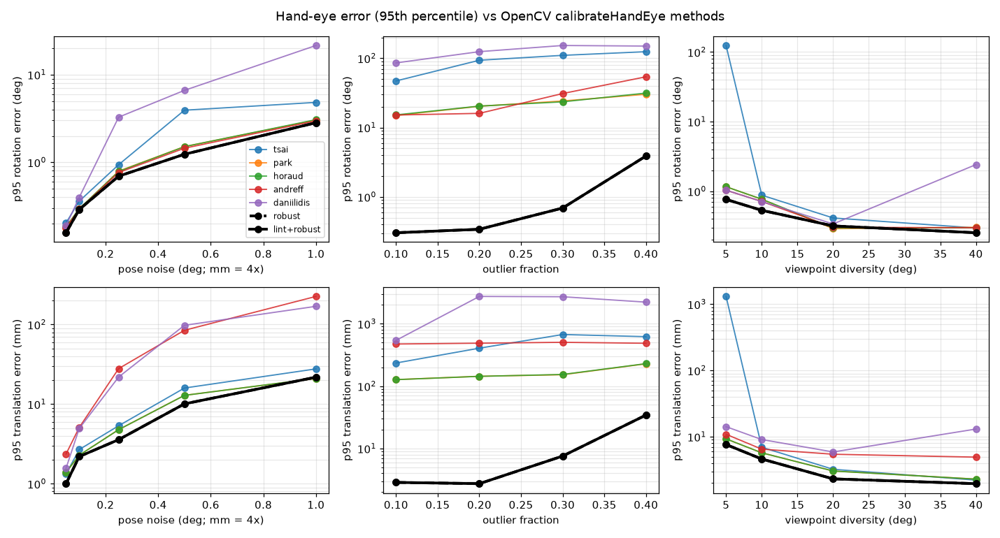

# handeye-lint: hand-eye calibration that knows when it is wrong

A Python library and CLI for robotics and vision engineers that checks recorded robot and camera poses for degenerate motion, frame/convention mistakes and outliers before an AX=XB hand-eye calibration, then solves it robustly.

## Results

- **20x lower worst-case rotation error with 10-40% bad poses:** 1.23° vs 24.7° (95th percentile) for the best OpenCV `calibrateHandEye` method, using RANSAC over motion pairs and robust SE(3) refinement.
- **Inverted or transposed poses caught and fixed automatically:** worst-case rotation error 0.27° vs 166° for OpenCV's methods, by testing which of 9 pose conventions makes the motion pairs agree.
- **Bad pose sets flagged with 100% precision on 2,000 held-out scenarios:** degenerate motions and swapped frames, plus individual outlier poses at 99.7% recall, with thresholds set on a separate split.



**Stack:** Python, NumPy, SciPy (`optimize.least_squares`, `spatial.transform`), OpenCV (`calib3d.calibrateHandEye`), Matplotlib, pytest, Hypothesis

## Quickstart

```bash
pip install -e ".[dev]"
handeye lint examples/eye_in_hand_swapped_frames.json
handeye solve examples/eye_to_hand_outliers.csv --setup eye_to_hand
```

The first file has its robot poses recorded as gripper_T_base instead of base_T_gripper; `lint` reports
`WARNING [convention-mismatch] robot poses look inverted ...`. The second has 4 corrupted samples out of
20; `solve` names them (`indices [3, 5, 6, 9]`) and returns base_T_camera within 0.2° and 0.5 mm of the
ground truth stored next to it in `examples/eye_to_hand_outliers.truth.json`.

## Why

OpenCV's `calibrateHandEye` offers five classical methods, and on real data they often disagree with
no hint about why. Forum users report
[translations from 0.14 to 0.21 against a true 0.22 across methods](https://forum.opencv.org/t/hand-to-eye-calibration-results-from-different-methods/7393)
and [outputs like 5.7e+12 on a real robot after the same code worked in simulation](https://forum.opencv.org/t/calibratehandeye-gives-back-huge-or-wrong-numbers-for-real-robot-but-worked-in-simulated/15894).
The usual causes are pose sets whose rotations share one axis, inverted or transposed poses (wrong
frame order, eye-to-hand data passed as eye-in-hand), and a few bad marker detections. Recent work
such as [Hydra (marker-free RGB-D hand-eye calibration)](https://arxiv.org/abs/2504.20584v1) reports
2-3x higher convergence to the global optimum than marker-based and marker-free baselines when only
a few robot configurations are available. `handeye-lint` stays with the standard pose-based AX=XB
workflow and checks for all three failure causes before you trust a number.

## Using it on your robot's poses

Input conventions match OpenCV: `robot_poses[i]` is base_T_gripper and `target_poses[i]` is
camera_T_target. Eye-in-hand returns gripper_T_camera; eye-to-hand returns base_T_camera.

JSON (each pose as `{"t": [x,y,z], "q": [qx,qy,qz,qw]}`, `{"t":..., "rvec": [...]}` or `{"matrix": 4x4}`;
add `"translation_scale": 0.001` if translations are in millimetres):

```json
{"setup": "eye_in_hand",
 "robot_poses":  [{"t": [0.41, -0.12, 0.33], "q": [0.01, 0.92, -0.05, 0.38]}, ...],
 "target_poses": [{"t": [0.02, 0.05, 0.47],  "q": [0.99, 0.03, 0.02, -0.08]}, ...]}
```

CSV with columns `robot_x,robot_y,robot_z,robot_qx,robot_qy,robot_qz,robot_qw,target_x,...,target_qw`
(pass `--setup eye_to_hand` when needed).

```bash
handeye lint poses.json --json        # machine-readable metrics and warnings
handeye lint poses.json --strict      # exit code 1 if any warning fires (for CI / capture scripts)
handeye solve poses.json --out x.json # robust solve; applies a detected convention fix unless --no-autofix
handeye simulate --out p.json --fault target_inverted --outliers 0.2   # synthetic data with ground truth
handeye bench --scenarios 2000 --out results --check                   # full benchmark (~3 min, 4 cores)
```

## How it works

Every pose pair (i, j) gives a motion pair A = H_j⁻¹H_i, B = C_jC_i⁻¹ with AX = XB, where H is the
robot pose (inverted for eye-to-hand) and C the target pose.

**Lint checks** (`handeye/lint.py`)

| Warning | Feature | Fires when |
|---|---|---|
| `degenerate-rotation-axes` | s₂/s₁ of the stacked rotation vectors of all robot motions (rotation-axis diversity; s₁/s₂ is reported as the condition number) | below 0.052: rotations share one axis, so translation along it is unobservable |
| `convention-mismatch` | log₁₀ of the RANSAC consistency cost of the data as given over the best of 9 conventions (robot × target ∈ {as given, inverted, rotation transposed}) | above 0.63 |
| `outlier-samples` | per-sample residual of the robust fit, normalised by the median residual | above 4.17, reported by index |

Convention faults cannot be seen pair by pair: the rotation angle and screw pitch of each relative
motion are unchanged when every pose is inverted or transposed. The linter therefore solves the
problem under each candidate convention and keeps the one whose motion pairs agree on a single X.
Inverting robot and target poses *together* is an exact symmetry (it swaps X with the constant
base/target transform), so a single inverted input has two equally consistent fixes; the tie is
broken with a physical prior (an eye-in-hand camera is near the flange, an eye-to-hand target is
near the gripper). Thresholds are picked to maximise F1 on a calibration split and stored in
`results/lint_thresholds.json`; the defaults in the code are those values.

**Robust solver** (`handeye/solver.py`)

1. *RANSAC over motion pairs.* Each hypothesis takes two motion pairs with well-separated rotation
   axes and solves the closed-form minimal problem: R_X aligns the axes of B (and their cross product)
   onto those of A via SVD; t_X solves (R_A − I)t_X = R_X t_B − t_A in least squares. 256 hypotheses are
   scored in one vectorised NumPy pass by the 25th percentile of the per-pair cost, which tolerates more
   than half of the pairs being contaminated (30% bad samples already spoil 51% of the pairs).
2. *Robust refinement on SE(3).* X and the constant transform T = H_i X C_i are refined jointly with
   `scipy.optimize.least_squares` on per-sample residuals log(T⁻¹H_i X C_i), first with a soft-L1 loss
   and then a Cauchy loss, each rescaled by the median residual. Per-sample residuals are independent
   (pair residuals are not), and they give one outlier score per recorded pose.

**Synthetic scenarios** (`handeye/sim.py`): eye-in-hand (camera 0–17 cm from the flange, board on
the table) and eye-to-hand (camera 0.8–1.5 m from the base, board in the gripper), viewpoints on a
cone looking at the board, Gaussian noise on both robot and target poses, gross target-pose
outliers (5–60° and 2–15 cm), near-parallel rotation axes (an orbit about one axis with up to 1°
wobble) and the four convention faults.

## Full results

`handeye bench --scenarios 2000 --out results --check` generates a 1,000-scenario calibration split
(seed 1) for the lint thresholds and a 2,000-scenario test split (seed 0) mixing five families. All
numbers below are from the test split; per-scenario rows are in `results/scenarios.csv`, sweep
tables in `results/sweeps.csv`, and every family's table in `results/RESULTS.md`.
`lint+robust` applies the lint's convention fix before solving; `robust` solves the data as given.

95th-percentile error per family (rotation in degrees / translation in mm):

| method | outliers (n=485) | convention fault (n=315) | noise only (n=619) | low diversity (n=405) | parallel axes (n=176) | all (n=2000) |
|---|---|---|---|---|---|---|
| Tsai | 98.8 / 503 | 166 / 1290 | 2.49 / 15.5 | 44.5 / 100 | 125 / 1250 | 127 / 704 |
| Park | 25.4 / 178 | 173 / 1290 | 1.77 / 13.0 | 0.857 / 6.52 | 146 / 5210 | 132 / 768 |
| Horaud | 24.7 / 176 | 173 / 1290 | 1.80 / 13.0 | 0.858 / 6.52 | 144 / 2160 | 133 / 664 |
| Andreff | 30.5 / 494 | 174 / 1310 | 1.67 / 179 | 0.767 / 7.31 | 3.20 / 551 | 127 / 512 |
| Daniilidis | 147 / 2450 | 173 / 2000 | 5.11 / 69.6 | 0.868 / 10.5 | 14.9 / 12400 | 143 / 1690 |
| robust | 1.23 / 12.9 | 171 / 1350 | 1.67 / 11.8 | 0.518 / 5.85 | 1.84 / 541 | 121 / 547 |
| **lint+robust** | **1.23 / 12.9** | **0.274 / 2.01** | **1.67 / 11.8** | **0.518 / 5.85** | **1.84 / 541** | **1.30 / 35.4** |

Lint warnings on the held-out test split:

| warning | unit | threshold | precision | recall | TP | FP | FN |
|---|---|---|---|---|---|---|---|
| degenerate-rotation-axes | scenario | 0.0522 | 1.000 | 1.000 | 176 | 0 | 0 |
| convention-mismatch | scenario | 0.626 | 1.000 | 1.000 | 315 | 0 | 0 |
| outlier-samples | sample | 4.17 | 1.000 | 0.997 | 2060 | 0 | 7 |

On noise-only scenarios there is no accuracy cost: 95th-percentile rotation error 1.67° vs 1.67° for
the best OpenCV method (Andreff) and translation 11.8 mm vs 13.0 mm (Park). Among detected
convention faults, the specific fault (which input, inverted or transposed) was
identified correctly in 100% of cases. With noise-free poses the robust solver recovers X to
better than 1e-3° and 1e-3 mm. On parallel-axis sets every method, including this one, has large
translation error, which is exactly why that case is a lint warning rather than something a
solver can fix.

`--check` makes the command exit non-zero unless: lint+robust beats every OpenCV method's p95
rotation and translation error on the outlier and convention families; its median error on the
noise family is within 1.5x of the best OpenCV method; noise-free recovery is exact; and every lint
warning reaches precision and recall ≥ 0.9 with ≥ 90% correct fault identification.

## Tests

```bash
python3 -m pytest -q
```

If the interpreter you test with already has some dependencies but not others (commonly OpenCV),
`scripts/install_local_deps.sh [python]` installs only the missing ones into a git-ignored `.deps/`
directory, which the package appends to `sys.path`; the interpreter's own environment is untouched.

25 tests, including Hypothesis property tests over random seeds and setups: exact recovery from
noise-free random poses (4–20 poses, both setups), exactness of the two-pair minimal solver,
invariance of X to re-labelling the robot base and target frames, robustness to 10–30% outliers
with every planted outlier scoring above every inlier, detection and correct identification of
planted inversions, and no warnings on clean data. Further tests cover transposed rotations, the
inversion symmetry, the parallel-axis warning, JSON/CSV round trips, the CLI and a small benchmark run.

## Design notes

- **Per-sample residuals rather than pair residuals for refinement.** All N(N−1)/2 pairs are used for
  RANSAC (more minimal samples, better coverage), but refining on pairs double-counts each pose and
  makes residuals correlated; refining X and T jointly on N independent residuals is the AX=YB form
  and is what makes per-pose outlier scores meaningful.
- **Quantile scoring instead of an inlier threshold.** Noise levels on real rigs vary by orders of
  magnitude; ranking hypotheses by a low quantile of the cost needs no noise threshold.
- **Lint before solve.** A robust solver cannot repair a convention fault (the `robust` row on the
  convention family is as wrong as OpenCV); only testing alternative conventions can.
- **OpenCV pinned below 5.0.** `calibrateHandEye` is no longer exposed at the top level of the
  `cv2` 5.0 Python module, so the dependency is `opencv-python-headless>=4.8,<5`.
- Regenerate examples with `python3 scripts/make_examples.py` and the README figure from benchmark
  output with `python3 scripts/make_figure.py`.

## Limitations and next steps

- All benchmark numbers are on synthetic scenarios. Planted outliers are gross (5–60°, 2–15 cm) and
  convention faults are whole-dataset; the near-perfect precision and recall reflect faults of that
  size, and subtler errors (a 1° marker flip, a single mis-ordered pose, time-sync offsets) will be
  harder to separate from noise. Validating on recorded datasets such as Hydra's released data is
  the next step.
- The convention fix chooses between the two exactly symmetric fixes with a geometric prior; a rig
  that breaks it (an eye-in-hand camera far from the flange, or an eye-to-hand board far from the
  gripper) can get the dual fix. Warnings report the costs so a user can check.
- Only the four common faults (inverted / transposed robot or target poses) are tested; mixed-up
  quaternion order (wxyz vs xyzw), unit mistakes and partial faults are not detected.
- The degeneracy check looks at rotation-axis diversity only; it does not warn about small total
  rotation or poorly spread translations, and the solver does not report a covariance.
- No marker detection, image processing, ROS integration or robot-world (AX=YB with unknown target
  pose) calibration beyond what the joint refinement already estimates.
